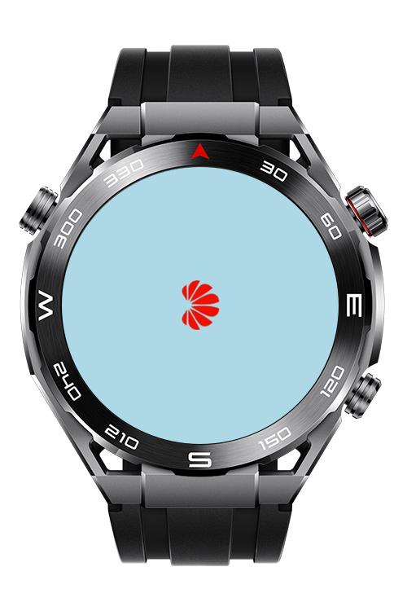
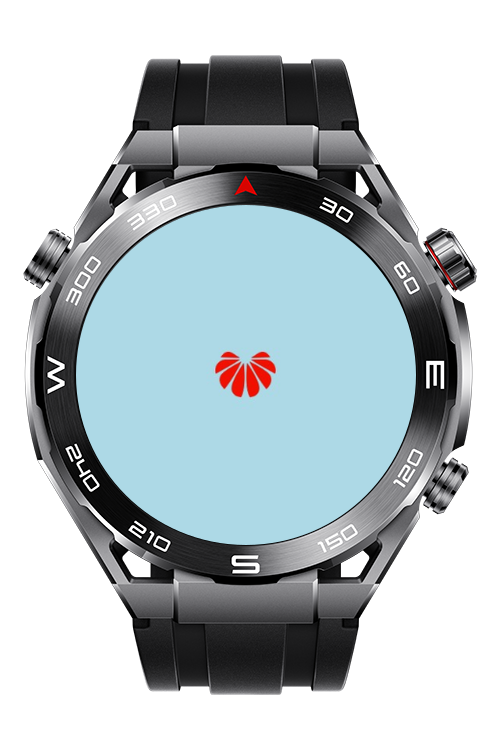

> **Note:** To access all shared projects, get information about environment setup, and view other guides, please visit [Explore-In-HMOS Index](https://github.com/Explore-In-HMOS/hmos-index).

# sportwatch-howto-create-spin

This project demonstrates a simple image rotation interaction built with HarmonyOS in Lite Wearable devices.
The app displays a centered image on the screen, which rotates by 90 degrees with each tap.
In addition, a right-swipe gesture allows users to exit the app instantly.

The rotation is handled through CSS keyframe animations that perform smooth transitions between each 90-degree step, giving users a responsive and visually engaging interaction.

# Preview

<div>
    
    
</div> 

# Use Cases

Gesture Interaction Demo: Showcases how user interactions like tapping or swiping can be mapped to visual feedback.

Animation Showcase: Useful for demonstrating CSS keyframe animation techniques in HarmonyOS environments.

Prototype Testing: Can serve as a lightweight prototype for UI gesture validation or testing input responsiveness.

Learning Resource: A practical example for beginners to understand event handling, animation triggers, and data binding in ArkTS-based development.

# Tech Stack

- **Languages**: JavaScript
- **Frameworks**: HarmonyOS SDK 4.0.0(10)
- **Tools**: DevEco Studio Vers 5.1.0.842

# Directory Structure
   ```
   src/main/js/MainAbility/pages/
   |---index
   |   |---Index.css                     // App CSS File
   |   |---Index.hml                     // App HML File
   |   |---Index.js                      // App Home Page
   ```

# Constraints and Restrictions
## Supported Devices
- Huawei Lite Wearable Devices

# License
**sportwatch-howto-create-spin** is distributed under the terms of the MIT License
See the [LICENSE](./LICENSE) for more information.